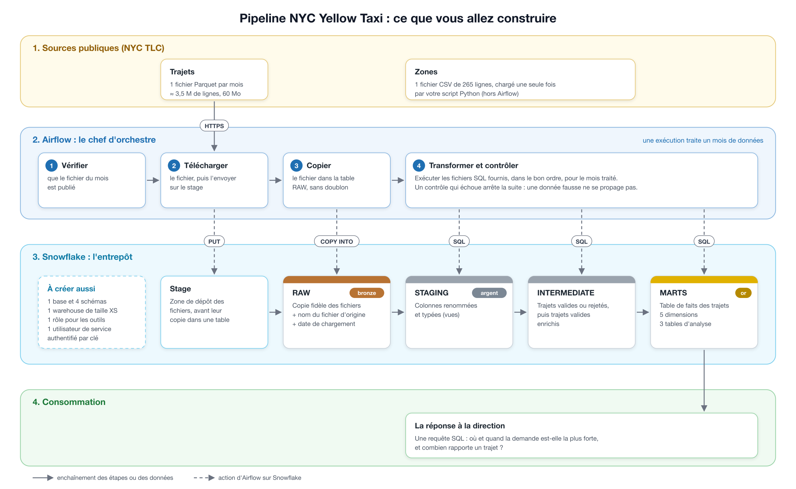

# Pipeline médaillon NYC Yellow Taxi — Snowflake et Airflow

Projet réalisé dans le cadre du parcours Data Engineer. Ce dépôt contient le
pipeline fonctionnel, ses validations et les éléments de preuve de la livraison
pour janvier à mars 2025.

Contributeur du projet : `ESNAULTQ`. Le projet est réalisé individuellement ;
aucun second membre de binôme n'est à ajouter.

## Dans quel ordre lire

1. **Le brief** (`doc/Contexte du projet NYC Taxi.txt`) : contexte et critères.
2. **Ce README** : architecture, démarrage et résultats de référence.
3. **`docs/ETAT_REEL_PROJET.md`** : travaux réellement exécutés et preuves
   encore à compléter avant le rendu final.
4. **`docs/JOURNAL_PROJET.md`** : chronologie des jours 1 à 5.
5. **`doc/GUIDE_DIRECTEUR_PROJET_NYC_TAXI.md`** : règles, compétences et
   critères de livraison.

## Ce que vous allez construire



## Contenu du dépôt

```
.
├── README.md                      ce fichier
├── ETAPES.md                      le détail de chaque journée
├── CONTRAT_RAW.md                 noms et colonnes que votre entrepôt doit contenir
├── verifier_poste.sh              vérifie Python, Git, Docker, Astro CLI, OpenSSL
├── .gitignore                     exclut les clés, le .env et les fichiers téléchargés
├── snowflake/                     infrastructure, objets RAW et réparation documentée
├── ingestion/                     loaders Python et test de connexion
├── docs/
│   ├── architecture.png           le schéma du pipeline
│   ├── parcours.png               les cinq journées en un coup d'œil
│   ├── FICHE_SOURCE_MODELE.md     modèle de fiche source (jour 1)
│   └── REPONSE_MODELE.md          modèle de réponse à la direction (jour 5)
└── airflow/
    ├── requirements.txt           dépendances Python du projet Airflow
    ├── .env.example               format de la connexion Snowflake
    ├── dags/                      DAG mensuel et test de connexion
    └── include/sql/               SQL de staging, intermediate, marts et contrôles
        ├── 00_tables.sql          crée les trois tables alimentées mois par mois
        ├── staging/               2 vues de renommage + les tables de codes
        ├── intermediate/          trajets étiquetés, puis trajets valides enrichis
        ├── marts/                 5 dimensions, la table de faits, 3 tables d'analyse
        └── controles/             contrôles qualité exécutés par le DAG
```

Les fichiers `.gitkeep` ne servent qu'à conserver les dossiers vides dans Git : vous pouvez les supprimer dès que vous y ajoutez un fichier.

## Selon votre système

| Système | Terminal à utiliser | Installation d'Astro CLI | À savoir |
|---|---|---|---|
| macOS | Terminal | `brew install astro` | Docker Desktop ou OrbStack |
| Linux | terminal habituel | `curl -sSL install.astronomer.io \| sudo bash -s` | Docker Engine suffit |
| Windows | **WSL avec Ubuntu**, pas PowerShell | la commande Linux, dans Ubuntu | activer l'intégration WSL dans Docker Desktop ; placer le projet dans le dossier personnel d'Ubuntu (`~`), pas sous `/mnt/c` : les droits du fichier de clé n'y fonctionnent pas |

Les commandes du brief et des guides (`openssl`, `awk`, `bash`, `python3`) sont celles d'un terminal macOS ou Linux. Sous Windows, elles s'exécutent telles quelles dans Ubuntu (WSL). Les consignes Windows n'ont pas été testées sur un poste réel.

## Lire les fichiers SQL fournis

Chaque fichier crée une vue ou une table, ou alimente une table pour le mois traité.

- **Les noms sont complets** (`NYC_TAXI.MARTS.FCT_TRIPS`) : la base, les schémas et les tables portent des noms imposés. Le nom du warehouse, du rôle et de l'utilisateur de service est libre.
- **Pour trouver l'ordre d'exécution** : chaque fichier lit des tables (`FROM`, `JOIN`) et en crée une. Un fichier s'exécute après ceux qui créent les tables qu'il lit. `00_tables.sql` passe avant tout le reste.
- **Ce qui est entre doubles accolades** est remplacé par Airflow avant l'exécution :

| Dans le fichier | Remplacé par | Exemple pour janvier 2025 |
|---|---|---|
| `{{ ds }}` | le premier jour du mois traité | `2025-01-01` |
| `{{ logical_date.strftime("%Y-%m") }}` | le mois traité | `2025-01` |
| `{{ params.xxx }}` | un paramètre à déclarer dans votre DAG | voir ci-dessous |

Exécuté tel quel dans Snowsight, un fichier qui contient des accolades échoue : remplacez-les d'abord à la main pour le tester.

Les quatre paramètres attendus par les fichiers fournis :

| Paramètre | Valeur | Utilisé par |
|---|---|---|
| `max_trip_distance_miles` | `100` | `intermediate/int_trips__flagged.sql` |
| `max_trip_duration_min` | `180` | `intermediate/int_trips__flagged.sql` |
| `start_month` | `"2025-01-01"` | `marts/dim_date.sql` |
| `end_month` | `"2025-04-01"` | `marts/dim_date.sql` |

## Le contrôle fourni

`controles/raw_mois_charge.sql` vérifie que le mois traité est bien présent dans
RAW. Les contrôles de parité, de taux de rejet, d'unicité et de présence des
faits sont également exécutés par le DAG. Une requête de contrôle renvoie une
seule ligne : si sa valeur est fausse, la tâche échoue et la suite ne s'exécute
pas.

## Démarrer le projet Airflow

Le projet Astro est déjà initialisé dans `airflow/`. La clé privée et le fichier
`.env` restent locaux et ne doivent jamais être ajoutés à Git. Démarrer :

```bash
astro dev start
```

L'adresse de l'interface est affichée à la fin de la commande.

- L'identifiant de connexion est `snowflake_nyc_taxi`.
- Activer `nyc_yellow_taxi_monthly` avec son interrupteur.
- Pour rejouer une exécution historique, utiliser **Clear** sur les tâches
  concernées ; ne pas utiliser `Trigger DAG` sans date logique explicite.

## Résultats attendus

| Table | Lignes après les trois mois |
|---|---|
| `RAW.YELLOW_TRIPDATA` | 11 198 026 (3 475 226 en janvier) |
| `RAW.TAXI_ZONE_LOOKUP` | 265 |
| `INTERMEDIATE.INT_TRIPS__FLAGGED` | 11 198 026 |
| `MARTS.FCT_TRIPS` | 10 382 378 |
| `MARTS.MART_ZONE_HOURLY_DEMAND` | 11 524 |
| `MARTS.MART_DATA_QUALITY` | 18 |

## État de l'implémentation NYC Taxi

Le pipeline de ce workspace est maintenant implémenté et validé sur janvier,
février et mars 2025 :

- Snowflake : `NYC_TAXI.RAW`, `STAGING`, `INTERMEDIATE` et `MARTS` ;
- ingestion Python mensuelle et chargement initial des 265 zones ;
- Airflow 3/Astro : connexion `snowflake_nyc_taxi`, catchup mensuel et
  `max_active_runs=1` ;
- contrôles bloquants : présence RAW, parité RAW/STAGING, taux de rejet,
  unicité de `trip_sk` et présence des faits ;
- timestamps Parquet lus avec `USE_VECTORIZED_SCANNER = TRUE` et
  `USE_LOGICAL_TYPE = TRUE`.

## Relancer le projet

Prérequis : Docker Desktop démarré, clé privée locale disponible et connexion
Airflow configurée dans l'interface sous l'identifiant
`snowflake_nyc_taxi`.

```bash
cd airflow
astro dev start
```

Ouvrir ensuite `http://airflow.localhost:6563`, activer le DAG
`nyc_yellow_taxi_monthly` et utiliser ses exécutions planifiées. Ne pas utiliser
`Trigger DAG` pour un mois historique : utiliser **Clear** sur l'exécution
correspondante.

## Livrables Day 5

- [Réponse métier](docs/REPONSE.md) : requête, top 10, interprétation et limites ;
- [Validation finale](docs/validation_day5.sql) : volumes, qualité, historique,
  droits et crédits ;
- [Plan de démonstration](docs/PLAN_DEMO.md) : déroulé de 15 minutes ;
- [Journal des jours 1 à 5](docs/JOURNAL_PROJET.md) : actions, preuves,
  incidents et décisions ;
- [Actual status](docs/ETAT_REEL_PROJET.md) : completed work versus pending
  evidence, without assumptions ;
- [Guide directeur](doc/GUIDE_DIRECTEUR_PROJET_NYC_TAXI.md) : architecture,
  sécurité, compétences et critères de livraison.
