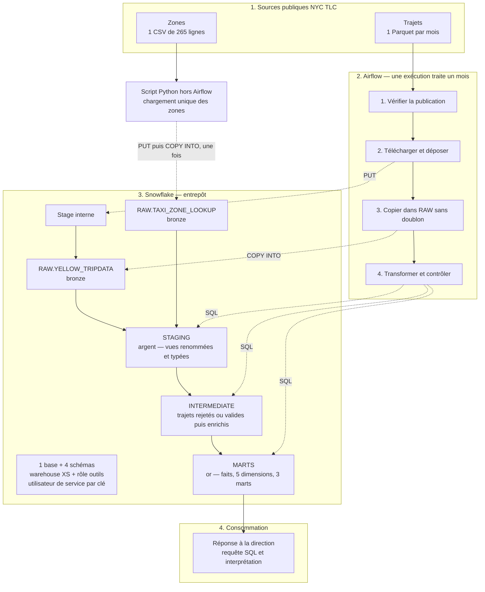
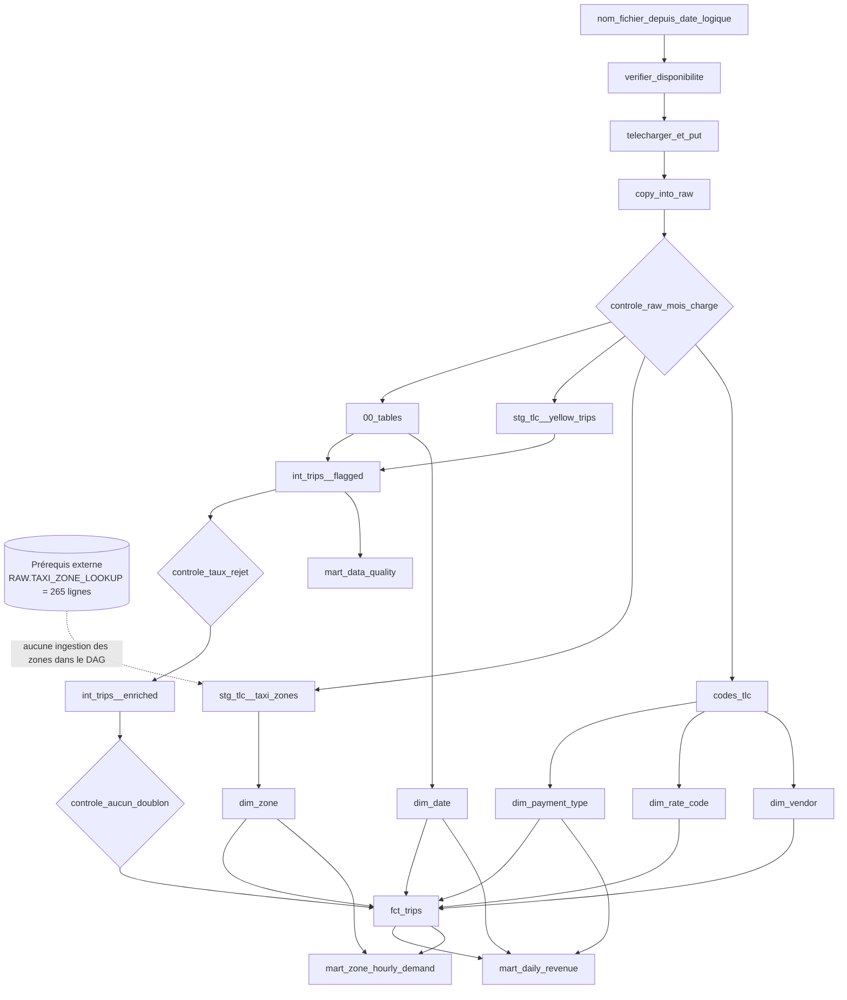

# Guide directeur du projet NYC Taxi

> Document de pilotage, de réalisation et de validation du pipeline NYC Yellow Taxi.
>
> Version : 1.0  
> Date de l'analyse : 5 octobre 2026  
> Périmètre de données : janvier, février et mars 2025  
> Durée prévue : 5 jours, projet individuel
> Sources principales : `doc/Contexte du projet NYC Taxi.txt` et `doc/Pipeline_nyc.png`

>
> **Mise à jour livraison — 9 octobre 2026.** Les sections décrivant le
> démarrage du 5 octobre sont conservées comme historique du projet. Pour
> connaître l'état réellement atteint, les captures disponibles et les actions
> restantes, consulter [`docs/ETAT_REEL_PROJET.md`](../docs/ETAT_REEL_PROJET.md).

---

## 1. Rôle de ce document

Ce guide est la référence opérationnelle du projet. Il doit être utilisé :

- au début de chaque journée, pour connaître le résultat à obtenir ;
- pendant l'implémentation, pour respecter les contrats et les règles non négociables ;
- avant chaque commit, pour contrôler la sécurité et la rejouabilité ;
- avant la livraison, pour vérifier les livrables et les compétences ;
- pendant la démonstration, comme fil conducteur.

Il ne remplace pas les fichiers fournis dans le starter kit. En cas de contradiction, l'ordre de priorité est :

1. le brief du projet et le schéma officiel `doc/Pipeline_nyc.png` ;
2. `CONTRAT_RAW.md` et les fichiers SQL fournis ;
3. `ETAPES.md` et le `README.md` du starter kit ;
4. les guides Snowflake et Airflow liés au brief ;
5. les tutoriels externes.

Le SQL fourni dans `airflow/include/sql/` est une donnée d'entrée du projet : **il ne doit pas être modifié**. L'infrastructure, la couche RAW et le DAG doivent s'adapter à ce contrat.

---

## 2. Résumé exécutif

### 2.1 Problème métier

Hudson Cab Partners exploite 180 taxis jaunes à New York. Le reporting mensuel est actuellement manuel, fragile, peu traçable et dépend d'une seule analyste. Le projet doit remplacer ce processus par un pipeline automatisé, documenté, rejouable et contrôlé.

### 2.2 Question à laquelle le projet doit répondre

> Où et quand la demande de taxis jaunes est-elle la plus forte à New York, et combien rapporte un trajet selon la zone, l'heure et le mode de paiement ?

La réponse doit distinguer au minimum :

- la zone de prise en charge ;
- l'heure de prise en charge ;
- le type de jour, si pertinent : semaine ou week-end ;
- le mode de paiement ;
- le nombre de trajets ;
- le nombre moyen de trajets par jour ;
- le montant total et le montant moyen par trajet.

### 2.3 Solution cible

Le projet construit :

- un entrepôt Snowflake en quatre couches : `RAW`, `STAGING`, `INTERMEDIATE`, `MARTS` ;
- une ingestion Python paramétrée par mois pour les trajets, plus un chargement unique des zones hors Airflow ;
- un DAG Apache Airflow 3 exécuté localement avec Astro CLI et Docker ;
- des transformations SQL fournies, exécutées dans l'ordre de leurs dépendances ;
- des contrôles qualité bloquants ;
- une réponse SQL documentée pour la direction ;
- un dépôt GitHub public, reproductible et sans secret.

### 2.4 Définition globale de la réussite

Le projet est terminé seulement si les conditions suivantes sont toutes vraies :

- janvier, février et mars 2025 ont chacun une exécution Airflow réussie ;
- relancer un mois ne change pas les nombres de lignes ;
- un contrôle volontairement mis en échec bloque les tâches suivantes ;
- les résultats de référence sont atteints ;
- le rôle technique suit le principe du moindre privilège ;
- Python et Airflow se connectent avec une paire de clés, jamais avec `ACCOUNTADMIN` ;
- aucun secret, fichier `.env`, fichier de clé ou fichier de données volumineux n'est dans Git ;
- le README permet à une autre équipe de reproduire le projet ;
- le contributeur sait expliquer toute l'architecture et tous les choix.

---

## 3. Contraintes et règles non négociables

| Domaine | Règle |
|---|---|
| Snowflake | Compte d'essai gratuit, édition Enterprise, région européenne |
| Calcul | Un seul warehouse, taille `XSMALL`, `AUTO_SUSPEND <= 60`, `AUTO_RESUME = TRUE`, initialement suspendu |
| Sécurité | Un rôle dédié aux outils et un utilisateur de service `TYPE = SERVICE` |
| Authentification | Paire de clés pour le script Python et Airflow |
| Administration | Les outils n'utilisent jamais `ACCOUNTADMIN` |
| Secrets | Aucun secret dans Git, le code, les logs, les captures ou l'image Docker |
| Contrat | Base `NYC_TAXI`, schémas et tables RAW avec les noms imposés |
| SQL fourni | Ne jamais modifier les fichiers fournis dans `airflow/include/sql/` |
| Orchestration | Apache Airflow 3, projet Astro local avec Docker |
| Période | Uniquement janvier à mars 2025 pour le périmètre évalué |
| Rejouabilité | Une relance d'un mois ne crée aucun doublon et ne modifie pas les autres mois |
| Versionnement | Dépôt GitHub public avec README reproductible |
| Organisation | Projet individuel : le même contributeur intervient sur Snowflake et Airflow |

Une violation de sécurité peut invalider une compétence même si le pipeline fonctionne. En particulier, `ACCOUNTADMIN` dans la connexion d'un outil ou une clé privée committée empêche la validation de C16.

---

## 4. État initial constaté le 5 octobre 2026 (historique)

Cette section décrit le point de départ et ne doit pas être relue comme une
liste d'actions encore à effectuer. Les critères de sortie actuels sont ceux de
la section 15 et du document d'état réel.

### 4.1 Contenu actuel du dossier de travail

Le dossier contient actuellement :

- `doc/Contexte du projet NYC Taxi.txt` ;
- `data/taxi_zone_lookup (1).csv`.

Le CSV local contient 266 lignes physiques : une ligne d'en-tête et **265 zones**, ce qui correspond au résultat attendu. Son nom devra être normalisé en `taxi_zone_lookup.csv` dans le futur projet d'ingestion.

Le starter kit n'est pas encore copié dans le dossier de travail et le dossier n'est pas encore un dépôt Git.

### 4.2 Vérification du poste

Résultat obtenu avec `verifier_poste.sh` du starter kit :

| Élément | État | Détail |
|---|---|---|
| Python 3.10+ | OK | Python 3.12.3 |
| Git | OK | Git 2.43.0 |
| Docker installé | OK | Docker 29.0.2 |
| Docker démarré | À corriger | Le moteur Docker doit être démarré |
| Astro CLI | À installer | Commande `astro` absente |
| OpenSSL | OK | OpenSSL 3.0.13 |

### 4.3 Actions obligatoires avant le jour 1

- [ ] Démarrer Docker et confirmer que `docker info` réussit.
- [ ] Installer Astro CLI, puis vérifier `astro version`.
- [ ] Récupérer le starter kit dans le futur dépôt du projet.
- [ ] Initialiser Git et créer le dépôt GitHub public.
- [ ] Exécuter `bash verifier_poste.sh` jusqu'à obtenir uniquement des `OK`.
- [ ] Créer le compte Snowflake Enterprise dans une région européenne.
- [ ] Noter l'identifiant `ORGANISATION-COMPTE`, sans l'ajouter au dépôt s'il est associé à d'autres informations sensibles.
- [ ] Décider si le binôme utilise un compte Snowflake commun ou deux comptes.

Commande de récupération ciblée du starter kit, fournie par les ressources du brief :

```bash
git clone --depth 1 --filter=blob:none --sparse https://github.com/gsoulat/formation-data-IA.git
cd formation-data-IA
git sparse-checkout set "99-Brief/Data-Engineer/Snowflake/Snowflake+Airflow/starter-kit"
cd ..
cp -R "formation-data-IA/99-Brief/Data-Engineer/Snowflake/Snowflake+Airflow/starter-kit" nyc-taxi-pipeline
cd nyc-taxi-pipeline
git init
```

Ne pas supprimer ou écraser le dossier de travail actuel sans en avoir sauvegardé les documents utiles.

---

## 5. Sources de données et périmètre

### 5.1 Sources

| Source | Producteur | Format | Fréquence | Accès | Utilisation |
|---|---|---|---|---|---|
| Yellow Taxi Trip Records | NYC Taxi & Limousine Commission | Parquet | Mensuelle | Public, HTTPS | Une ligne par trajet ; ingestion mensuelle orchestrée par Airflow |
| Taxi Zone Lookup | NYC TLC | CSV | Référentiel | Public, HTTPS | Correspondance identifiant-zone ; chargement unique par Python, hors Airflow |
| Data Dictionary Yellow Taxi | NYC TLC | PDF | Documentation | Public | Signification des colonnes et codes |

URLs de données :

```text
https://d37ci6vzurychx.cloudfront.net/trip-data/yellow_tripdata_2025-01.parquet
https://d37ci6vzurychx.cloudfront.net/trip-data/yellow_tripdata_2025-02.parquet
https://d37ci6vzurychx.cloudfront.net/trip-data/yellow_tripdata_2025-03.parquet
https://d37ci6vzurychx.cloudfront.net/misc/taxi_zone_lookup.csv
```

### 5.2 Volumes de référence

Chaque valeur mesurée doit être inscrite dans la fiche source, avec la commande utilisée. Les valeurs ci-dessous servent de critères d'acceptation de l'entrepôt, pas de remplacement à la mesure :

| Objet | Résultat attendu |
|---|---:|
| Fichier de janvier | 3 475 226 trajets |
| Référentiel des zones | 265 lignes |
| `RAW.YELLOW_TRIPDATA`, trois mois | 11 198 026 lignes |
| `INTERMEDIATE.INT_TRIPS__FLAGGED` | 11 198 026 lignes |
| `MARTS.FCT_TRIPS` | 10 382 378 lignes |
| `MARTS.MART_ZONE_HOURLY_DEMAND` | 11 524 lignes |
| `MARTS.MART_DATA_QUALITY` | 18 lignes |

### 5.3 Codes de référence

Les codes métier utilisés par les transformations fournies doivent être reportés dans la fiche source.

**Modes de paiement**

| Code | Libellé |
|---:|---|
| 0 | Flex Fare trip |
| 1 | Credit card |
| 2 | Cash |
| 3 | No charge |
| 4 | Dispute |
| 5 | Unknown |
| 6 | Voided trip |

**Types de tarif**

| Code | Libellé |
|---:|---|
| 1 | Standard rate |
| 2 | JFK |
| 3 | Newark |
| 4 | Nassau or Westchester |
| 5 | Negotiated fare |
| 6 | Group ride |
| 99 | Null or unknown |

**Fournisseurs**

| Code | Libellé |
|---:|---|
| 1 | Creative Mobile Technologies, LLC |
| 2 | Curb Mobility, LLC |
| 6 | Myle Technologies Inc |
| 7 | Helix |

`store_and_fwd_flag` vaut `Y` si le trajet a été temporairement conservé dans le véhicule avant transmission, et `N` dans le cas contraire. Les libellés doivent être confrontés au dictionnaire TLC 2025 lors de la rédaction de la fiche source ; les tables ci-dessus reproduisent le référentiel utilisé par le SQL fourni.

### 5.4 Imperfections connues

Les données sont réelles. Il faut s'attendre notamment à :

- des distances manquantes, égales à zéro ou négatives ;
- des montants négatifs ou non positifs ;
- des dates hors du mois annoncé par le nom du fichier ;
- des durées nulles, négatives ou excessives ;
- des zones absentes ;
- des doublons métier ;
- des colonnes dont le type physique varie entre les mois ;
- l'apparition de `cbd_congestion_fee` dans les fichiers récents.

La couche RAW conserve les données telles qu'elles sont publiées. Les rejets métier sont identifiés dans `INTERMEDIATE`, jamais effacés silencieusement à l'ingestion.

### 5.5 Limites métier à annoncer

- Les données TLC décrivent l'ensemble des taxis jaunes, pas uniquement les 180 véhicules d'Hudson Cab Partners.
- Elles mesurent la demande observée, pas la demande non satisfaite.
- Trois mois d'hiver ne suffisent pas à conclure sur la saisonnalité annuelle.
- `total_amount` est un montant facturé, pas un bénéfice : les coûts d'exploitation ne sont pas présents.
- Les pourboires ne sont fiables que pour les paiements par carte ; les pourboires en espèces ne sont généralement pas enregistrés.
- Les heures des trajets sont stockées sans fuseau (`TIMESTAMP_NTZ`) et doivent être interprétées selon la convention locale de la source TLC.
- Les trajets écartés par les règles qualité peuvent introduire un biais ; leur part doit être publiée.
- La zone analysée est la zone de prise en charge, sauf mention contraire.

---

## 6. Architecture cible

Le fichier [`Pipeline_nyc.png`](Pipeline_nyc.png) est la **référence visuelle officielle** de l'architecture finale. Toute implémentation et tout diagramme du README doivent rester cohérents avec lui.


Le schéma impose quatre ensembles distincts :

1. **Sources publiques TLC** : Parquet mensuels des trajets et CSV de 265 zones.
2. **Airflow, chef d'orchestre** : pour chaque mois, vérifier, télécharger/déposer, copier dans RAW, transformer et contrôler.
3. **Snowflake, entrepôt** : infrastructure, stage puis couches `RAW`, `STAGING`, `INTERMEDIATE` et `MARTS`.
4. **Consommation** : une requête SQL depuis `MARTS` vers la réponse destinée à la direction.

La distinction la plus importante est la suivante :

- **trajets** : un fichier Parquet par mois ; une exécution Airflow traite exactement un mois ;
- **zones** : un unique CSV de 265 lignes, chargé une seule fois par le script Python **hors Airflow** ;
- Airflow peut ensuite exécuter la vue STAGING et la dimension des zones, mais il ne retélécharge pas le CSV à chaque run mensuel.

Représentation logique détaillée :



### 6.1 Responsabilité de chaque composant

| Composant | Responsabilité | Ne doit pas faire |
|---|---|---|
| Python d'ingestion local | Charger un mois manuellement au jour 2 et charger une seule fois le CSV des zones hors Airflow | Transformer les règles métier, embarquer un secret ou planifier les mois |
| Airflow | Pour chaque mois de trajets : vérifier, télécharger/`PUT`, `COPY INTO`, transformer, contrôler et permettre la relance | Retélécharger les zones à chaque run, contenir tout le SQL ou choisir le mois avec la date du jour |
| Stage Snowflake | Stocker temporairement les fichiers avant copie | Servir de table d'analyse |
| RAW | Conserver une copie fidèle, large et traçable | Filtrer les anomalies métier |
| STAGING | Renommer et typer, sans filtrer | Changer le nombre de lignes |
| INTERMEDIATE | Attribuer les rejets, dédupliquer, enrichir | Masquer les règles ou mélanger les grains |
| MARTS | Exposer faits, dimensions et indicateurs utiles | Dépendre d'un fichier local ou d'un notebook manuel |
| `REPONSE.md` | Présenter la requête, le top 10, trois conclusions et les limites | Présenter un chiffre impossible à retracer |

### 6.2 Lecture médaillon du schéma

- `RAW` est la couche **bronze** : copie fidèle, fichier source et date de chargement.
- `STAGING` est la couche **argent** du schéma : noms et types harmonisés dans des vues.
- `INTERMEDIATE` est la couche de travail qualité : tous les trajets sont marqués, puis les trajets valides sont dédupliqués et enrichis.
- `MARTS` est la couche **or** : une table de faits, cinq dimensions et trois tables d'analyse.
- La consommation se fait depuis `MARTS`, jamais directement depuis le stage, RAW ou un notebook local.

### 6.3 Modèle de données

| Couche | Objet | Grain ou fonction |
|---|---|---|
| RAW | `YELLOW_TRIPDATA` | Une ligne publiée par trajet, avant règles métier |
| RAW | `TAXI_ZONE_LOOKUP` | Une ligne par identifiant de zone |
| STAGING | `STG_TLC__YELLOW_TRIPS` | Même nombre de lignes que RAW, noms et types normalisés |
| STAGING | `STG_TLC__TAXI_ZONES` | Référentiel des zones normalisé |
| STAGING | Tables de codes | Libellés fournisseur, tarif et paiement |
| INTERMEDIATE | `INT_TRIPS__FLAGGED` | Tous les trajets, avec zéro ou une raison de rejet |
| INTERMEDIATE | `INT_TRIPS__ENRICHED` | Trajets valides, dédoublonnés et enrichis |
| MARTS | `FCT_TRIPS` | Une ligne par trajet valide |
| MARTS | `DIM_DATE` | Une ligne par date du périmètre |
| MARTS | `DIM_ZONE` | Une ligne par zone |
| MARTS | `DIM_PAYMENT_TYPE` | Une ligne par mode de paiement |
| MARTS | `DIM_RATE_CODE` | Une ligne par type de tarif |
| MARTS | `DIM_VENDOR` | Une ligne par fournisseur |
| MARTS | `MART_DAILY_REVENUE` | Jour × mode de paiement |
| MARTS | `MART_ZONE_HOURLY_DEMAND` | Zone de départ × heure × semaine/week-end |
| MARTS | `MART_DATA_QUALITY` | Fichier × statut qualité |

### 6.4 Attention à la question métier

`MART_ZONE_HOURLY_DEMAND` ne contient pas le mode de paiement. Il répond à la partie zone × heure × type de jour, mais pas seul à toute la question centrale. La requête finale doit donc utiliser `FCT_TRIPS` avec `DIM_ZONE` et `DIM_PAYMENT_TYPE`, ou construire un agrégat équivalent sans modifier le SQL fourni.

---

## 7. Contrat Snowflake

### 7.1 Noms imposés et noms libres

| Objet | Nom | Statut |
|---|---|---|
| Base | `NYC_TAXI` | Imposé |
| Schémas | `RAW`, `STAGING`, `INTERMEDIATE`, `MARTS` | Imposés |
| Table RAW trajets | `NYC_TAXI.RAW.YELLOW_TRIPDATA` | Imposé |
| Table RAW zones | `NYC_TAXI.RAW.TAXI_ZONE_LOOKUP` | Imposé |
| Warehouse | Proposition : `NYC_TAXI_WH` | Libre |
| Rôle outils | Proposition : `NYC_TAXI_ENGINEER` | Libre |
| Utilisateur de service | Proposition : `NYC_TAXI_AIRFLOW_SVC` | Libre |
| Stage | Proposition : `NYC_TAXI_STAGE` | Libre |
| Formats | Propositions : `PARQUET_FF`, `CSV_FF` | Libres |

Choisir les noms libres une seule fois, les documenter dans le README et les réutiliser partout.

### 7.2 Contrat de `RAW.YELLOW_TRIPDATA`

| Colonne | Type Snowflake recommandé | Remarque |
|---|---|---|
| `vendorid` | `INTEGER` | Code fournisseur |
| `tpep_pickup_datetime` | `TIMESTAMP_NTZ` | Sans fuseau |
| `tpep_dropoff_datetime` | `TIMESTAMP_NTZ` | Sans fuseau |
| `passenger_count` | `INTEGER` | Peut être nul |
| `trip_distance` | `FLOAT` | Ne pas utiliser `NUMBER` sans décimales |
| `ratecodeid` | `INTEGER` | Peut être nul |
| `store_and_fwd_flag` | `VARCHAR` | `Y` ou `N` |
| `pulocationid` | `INTEGER` | Zone de prise en charge |
| `dolocationid` | `INTEGER` | Zone de dépose |
| `payment_type` | `INTEGER` | Code TLC |
| `fare_amount` | `FLOAT` | Montant décimal |
| `extra` | `FLOAT` | Montant décimal |
| `mta_tax` | `FLOAT` | Montant décimal |
| `tip_amount` | `FLOAT` | Montant décimal |
| `tolls_amount` | `FLOAT` | Montant décimal |
| `improvement_surcharge` | `FLOAT` | Montant décimal |
| `total_amount` | `FLOAT` | Montant décimal |
| `congestion_surcharge` | `FLOAT` | Montant décimal |
| `airport_fee` | `FLOAT` | Montant décimal |
| `cbd_congestion_fee` | `FLOAT` | Peut varier selon le mois |
| `_source_file` | `VARCHAR` | Nom exact du fichier, sans dossier |
| `_loaded_at` | `TIMESTAMP_NTZ` | Horodatage de chargement |

### 7.3 Contrat de `RAW.TAXI_ZONE_LOOKUP`

| Colonne | Type Snowflake recommandé |
|---|---|
| `locationid` | `INTEGER` |
| `borough` | `VARCHAR` |
| `zone` | `VARCHAR` |
| `service_zone` | `VARCHAR` |
| `_source_file` | `VARCHAR` |
| `_loaded_at` | `TIMESTAMP_NTZ` |

### 7.4 Règles de chargement RAW

- Les fichiers sont déposés à la racine du stage.
- `_source_file` doit valoir par exemple `yellow_tripdata_2025-01.parquet`, sans préfixe de dossier.
- `MATCH_BY_COLUMN_NAME = CASE_INSENSITIVE` absorbe les différences de casse et les colonnes absentes selon le mois.
- `INCLUDE_METADATA` remplit `_source_file` et `_loaded_at`.
- `ON_ERROR = ABORT_STATEMENT` évite les chargements partiels silencieux.
- `FORCE = TRUE` est interdit dans le flux normal.
- `AUTO_COMPRESS = FALSE` conserve le nom du Parquet.
- `OVERWRITE = FALSE` évite de renvoyer inutilement le même fichier.
- Un type `FLOAT` est utilisé pour les montants et distances afin d'éviter l'arrondi de `NUMBER` sans échelle.

### 7.5 Point de vigilance sur l'idempotence RAW

Snowflake mémorise les fichiers déjà copiés dans une table et ignore normalement un second `COPY INTO` du même fichier. Cette mémoire de chargement est limitée dans le temps. Pour le périmètre de cinq jours, l'absence de `FORCE` répond au besoin. Pour une exploitation longue durée, il faudrait ajouter un registre durable des fichiers ou définir une stratégie explicite de remplacement ; cette extension est hors périmètre du brief.

Après un `DELETE`, Snowflake peut toujours considérer le fichier comme déjà chargé. Pour reconstruire entièrement RAW pendant le projet, utiliser la procédure documentée avec `TRUNCATE`, puis recharger tous les fichiers nécessaires. Ne pas faire cette opération sans avoir mesuré son impact.

---

## 8. Sécurité, droits et maîtrise des coûts

### 8.1 Principe d'administration

Séparer les responsabilités :

- `USERADMIN` : création du rôle et de l'utilisateur de service ;
- `SYSADMIN` : création du warehouse, de la base et des schémas ;
- rôle des outils : création et propriété des formats, du stage, des tables et des vues du pipeline ;
- `ACCOUNTADMIN` : uniquement pour les opérations d'administration qui l'exigent, par exemple la mesure finale des crédits.

Le rôle personnalisé doit être rattaché à `SYSADMIN` pour rester administrable.

### 8.2 Privilèges minimaux attendus

| Cible | Privilèges du rôle outils |
|---|---|
| Warehouse | `USAGE`, `OPERATE` |
| Base `NYC_TAXI` | `USAGE` |
| Schéma `RAW` | `USAGE`, `CREATE TABLE`, `CREATE STAGE`, `CREATE FILE FORMAT` |
| Schémas `STAGING`, `INTERMEDIATE`, `MARTS` | `USAGE`, `CREATE TABLE`, `CREATE VIEW` |
| Objets créés par le rôle | Droits liés à `OWNERSHIP` |

Le rôle ne doit pas avoir :

- `ACCOUNTADMIN` ou un rôle système trop puissant ;
- `CREATE DATABASE` ou `CREATE SCHEMA` ;
- de droits sur une autre base ;
- de droits accordés inutilement via `PUBLIC`.

### 8.3 Preuves de sécurité à conserver

```sql
SHOW GRANTS TO ROLE NYC_TAXI_ENGINEER;
SHOW GRANTS OF ROLE NYC_TAXI_ENGINEER;
SHOW GRANTS TO USER NYC_TAXI_AIRFLOW_SVC;
SHOW TABLES IN SCHEMA NYC_TAXI.RAW;
SHOW STAGES IN SCHEMA NYC_TAXI.RAW;
SHOW FILE FORMATS IN SCHEMA NYC_TAXI.RAW;
```

Test positif : le rôle peut lire et construire dans le périmètre prévu.  
Test négatif obligatoire : il ne peut pas créer un schéma ou accéder à un objet hors périmètre.

Exemple :

```sql
USE ROLE NYC_TAXI_ENGINEER;
CREATE SCHEMA NYC_TAXI.INTERDIT; -- doit échouer
```

### 8.4 Paire de clés

Règles :

- la clé privée reste sur le poste ou dans un coffre de secrets ;
- permissions locales recommandées : `chmod 600` ;
- la clé publique seule est enregistrée dans Snowflake ;
- la clé privée n'est jamais envoyée par messagerie ;
- elle n'est jamais copiée dans l'image Docker ;
- une clé différente par personne ou service est préférable à une clé partagée ;
- la rotation peut utiliser `RSA_PUBLIC_KEY_2` avant le retrait de l'ancienne clé.

Avant chaque push :

```bash
git status --short
git check-ignore airflow/.env
git ls-files | grep -E '(^|/)(\.env|.*\.p8|.*\.pem)$' && echo "ALERTE: secret suivi par Git"
git grep -nE 'BEGIN (RSA |ENCRYPTED )?PRIVATE KEY|private_key_content' -- ':!*.example'
```

Si une vraie clé a été commitée, la supprimer du dépôt ne suffit pas : il faut immédiatement la révoquer ou la faire tourner, puis nettoyer l'historique Git.

### 8.5 Configuration du warehouse

Le script versionné doit créer un unique warehouse avec :

```sql
WAREHOUSE_SIZE = 'XSMALL'
AUTO_SUSPEND = 60
AUTO_RESUME = TRUE
INITIALLY_SUSPENDED = TRUE
```

Ne pas utiliser une taille supérieure pour compenser un problème de requête ou de DAG sans diagnostic.

### 8.6 Mesure des crédits

À exécuter ponctuellement avec `ACCOUNTADMIN` le jour 5, jamais depuis Python ou Airflow :

```sql
USE ROLE ACCOUNTADMIN;

SELECT
    warehouse_name,
    DATE(start_time) AS jour,
    ROUND(SUM(credits_used), 3) AS credits
FROM SNOWFLAKE.ACCOUNT_USAGE.WAREHOUSE_METERING_HISTORY
WHERE start_time >= DATEADD(day, -7, CURRENT_TIMESTAMP())
  AND warehouse_name = 'NYC_TAXI_WH'
GROUP BY 1, 2
ORDER BY 2;
```

Les chiffres peuvent apparaître avec un retard allant jusqu'à environ trois heures. Conserver une capture montrant le warehouse, les jours et les crédits.

---

## 9. Structure cible du dépôt

```text
.
├── README.md
├── ETAPES.md
├── CONTRAT_RAW.md
├── verifier_poste.sh
├── .gitignore
├── snowflake/
│   ├── 01_infrastructure.sql
│   ├── 02_raw_objects.sql
│   └── 03_verifications.sql
├── ingestion/
│   ├── load_month.py
│   ├── load_zones.py                 # ou une option du même script
│   └── requirements.txt
├── airflow/
│   ├── Dockerfile
│   ├── requirements.txt
│   ├── .env.example
│   ├── .env                          # local, ignoré
│   ├── dags/
│   │   └── nyc_taxi_pipeline.py
│   └── include/sql/
│       ├── 00_tables.sql             # fourni, non modifié
│       ├── staging/                  # fourni, non modifié
│       ├── intermediate/             # fourni, non modifié
│       ├── marts/                    # fourni, non modifié
│       └── controles/
│           ├── raw_mois_charge.sql   # fourni, non modifié
│           ├── taux_rejet_acceptable.sql
│           └── aucun_doublon.sql
└── docs/
    ├── architecture.png              # schéma officiel, équivalent de doc/Pipeline_nyc.png
    ├── fiche_trajets.md
    ├── fiche_zones.md
    ├── REPONSE.md
    └── ../doc/capture/
```

### 9.1 Conventions de code

- Noms Python : `snake_case` ; constantes : `UPPER_SNAKE_CASE`.
- Noms Snowflake : cohérents et qualifiés par base et schéma dans le SQL.
- Un fichier SQL fourni = une tâche Airflow.
- Ne pas copier de longues requêtes SQL dans le DAG.
- Fonctions courtes, journalisation sans secret et messages d'erreur explicites.
- Toute commande du README doit avoir été exécutée sur un poste propre ou dans un environnement neuf.
- Les valeurs configurables sont des paramètres ou variables d'environnement, pas des valeurs dispersées dans le code.
- Les commits doivent être petits et décrire un résultat vérifiable, par exemple `feat(ingestion): load a monthly parquet idempotently`.

### 9.2 Organisation du travail

Le projet est individuel : le même contributeur a réalisé et vérifié les
parties Snowflake, Python et Airflow. Le journal de décisions et les contrôles
de validation servent de relecture interne et de traçabilité.

---

## 10. Conception du script Python d'ingestion

L'image d'architecture fixe deux usages distincts :

- `load_month.py` sert d'abord à prouver le chargement rejouable d'un mois au jour 2 ; sa logique est ensuite transposée dans les tâches du DAG ;
- `load_zones.py`, ou une commande explicitement dédiée dans le même programme, charge le référentiel une seule fois **hors Airflow**.

Le DAG mensuel ne doit donc appeler ni retélécharger le fichier des zones. Il suppose que `RAW.TAXI_ZONE_LOOKUP` a déjà été initialisée et contrôlée.

### 10.1 Interface attendue

Le script doit recevoir explicitement un mois au format `YYYY-MM` :

```bash
python ingestion/load_month.py 2025-01
```

Il doit :

1. valider le format du mois et, pour l'évaluation, son appartenance au périmètre ;
2. construire le nom `yellow_tripdata_YYYY-MM.parquet` ;
3. construire l'URL officielle ;
4. télécharger le fichier en flux, sans le charger entièrement en mémoire ;
5. ouvrir une connexion Snowflake par clé privée ;
6. exécuter `PUT` vers la racine du stage ;
7. exécuter `COPY INTO RAW.YELLOW_TRIPDATA` avec les options du contrat ;
8. afficher le statut et le nombre de lignes chargées ;
9. fermer la connexion et supprimer le fichier temporaire dans un bloc `finally` ;
10. retourner un code non nul en cas d'erreur.

Le chargement des zones peut être une commande séparée ou une option documentée du même script, par exemple :

```bash
python ingestion/load_zones.py
```

Cette commande est exécutée une seule fois pendant l'initialisation, hors Airflow. Elle doit néanmoins être rejouable et conserver exactement 265 lignes.

### 10.2 Dépendances minimales

```text
requests
snowflake-connector-python
cryptography
```

Pinner raisonnablement les versions dans le livrable final après avoir testé l'environnement. Éviter un environnement global ; utiliser un environnement virtuel.

### 10.3 Configuration sans secret dans le code

Variables possibles pour le script local :

```text
SNOWFLAKE_ACCOUNT
SNOWFLAKE_USER
SNOWFLAKE_ROLE
SNOWFLAKE_WAREHOUSE
SNOWFLAKE_DATABASE
SNOWFLAKE_SCHEMA
SNOWFLAKE_PRIVATE_KEY_PATH
```

Le README doit fournir des valeurs d'exemple, jamais une clé ou une vraie configuration complète.

### 10.4 Critères d'acceptation de l'ingestion

- [ ] Une commande avec `2025-01` charge exactement 3 475 226 lignes.
- [ ] `_source_file` vaut exactement `yellow_tripdata_2025-01.parquet`.
- [ ] `_loaded_at` est renseigné.
- [ ] Les décimales de `fare_amount` et `total_amount` sont préservées.
- [ ] Une seconde exécution ajoute zéro ligne.
- [ ] `COPY_HISTORY` prouve que le fichier n'a été chargé qu'une fois.
- [ ] Le CSV des zones produit exactement 265 lignes et 265 `locationid` distincts.
- [ ] Une erreur HTTP ou Snowflake interrompt clairement le script.
- [ ] Aucun fichier temporaire ne reste après succès ou échec.

### 10.5 Requêtes de vérification RAW

```sql
SELECT _source_file, COUNT(*) AS nb_rows, MIN(_loaded_at) AS first_loaded_at
FROM NYC_TAXI.RAW.YELLOW_TRIPDATA
GROUP BY 1
ORDER BY 1;

SELECT COUNT(*) AS nb_zones,
       COUNT(DISTINCT locationid) AS nb_location_ids
FROM NYC_TAXI.RAW.TAXI_ZONE_LOOKUP;

SELECT fare_amount, total_amount
FROM NYC_TAXI.RAW.YELLOW_TRIPDATA
LIMIT 10;

SELECT file_name, status, row_count, last_load_time
FROM TABLE(NYC_TAXI.INFORMATION_SCHEMA.COPY_HISTORY(
    TABLE_NAME => 'RAW.YELLOW_TRIPDATA',
    START_TIME => DATEADD(day, -7, CURRENT_TIMESTAMP())
));
```

---

## 11. Conception du DAG Airflow 3

Le périmètre du DAG est le flux **mensuel des trajets**. Chaque run correspond à un seul mois de Parquet. Le CSV des zones est un prérequis chargé hors DAG ; seules ses transformations STAGING/MARTS peuvent être rejouées dans le DAG.

### 11.1 Configuration obligatoire

| Paramètre | Valeur attendue |
|---|---|
| `schedule` | `@monthly` |
| `start_date` | 1er janvier 2025, UTC |
| `end_date` | 1er mars 2025, UTC, selon le modèle fourni |
| `catchup` | `True` explicitement |
| `max_active_runs` | `1` |
| Connexion | `snowflake_nyc_taxi` |
| Recherche SQL | `/usr/local/airflow/include/sql` |
| Retries réseau | 2, avec délai raisonnable |
| Retries contrôles | 0 |

Paramètres attendus par le SQL fourni :

```python
params={
    "max_trip_distance_miles": 100,
    "max_trip_duration_min": 180,
    "start_month": "2025-01-01",
    "end_month": "2025-04-01",
    "max_rejection_pct": 10,
}
```

Le seuil de rejet de 10 % est une hypothèse initiale à confirmer à partir des données. Il doit être justifié dans le README et ne doit pas être augmenté uniquement pour faire passer le pipeline.

### 11.2 Compatibilité Airflow 3

Utiliser :

```python
from airflow.sdk import dag, task, TaskGroup, get_current_context
```

Ne pas utiliser les formes Airflow 2 suivantes :

- `from airflow.decorators import ...` ;
- `schedule_interval=...` ;
- `execution_date` ;
- l'hypothèse que `catchup=True` est la valeur par défaut.

### 11.3 Date logique

Le nom de fichier doit être dérivé de la date logique :

```python
ctx = get_current_context()
month = ctx["data_interval_start"].strftime("%Y-%m")
filename = f"yellow_tripdata_{month}.parquet"
```

Il est interdit d'utiliser `datetime.now()`, `date.today()` ou `pendulum.today()` pour choisir le fichier. Une relance du run de janvier en octobre doit toujours traiter janvier.

### 11.4 Connexion Airflow

`airflow/.env` contient la connexion `AIRFLOW_CONN_SNOWFLAKE_NYC_TAXI`. La clé privée y est encodée sur une ligne avec `\n`. Ce fichier est ignoré par Git et Docker.

Après toute modification de `.env` :

```bash
astro dev restart
astro dev run connections get snowflake_nyc_taxi
```

Avant le vrai DAG, créer un DAG sans planification qui exécute :

```sql
SELECT CURRENT_USER(), CURRENT_ROLE(), CURRENT_WAREHOUSE();
```

Le log doit afficher l'utilisateur de service, le rôle technique et le warehouse XS.

### 11.5 Ordre recommandé des tâches



La dépendance des dimensions avant `FCT_TRIPS` n'est pas imposée par la requête SQL de la table de faits, mais elle rend le modèle dimensionnel complet avant l'exposition des faits et facilite les contrôles d'intégrité.

`Z0` représente un prérequis externe, pas une tâche Airflow : le script Python a déjà chargé les zones une fois. `stg_tlc__taxi_zones` et `dim_zone` restent bien des tâches SQL rejouables.

### 11.6 Groupes de tâches

Utiliser au minimum des `TaskGroup` lisibles :

- `ingestion` ;
- `staging` ;
- `intermediate` ;
- `marts` ;
- éventuellement `quality_checks` si les contrôles restent positionnés au bon endroit.

Un contrôle doit se trouver juste après la donnée qu'il vérifie et avant tous ses consommateurs. Un groupe purement visuel ne doit jamais affaiblir cette règle.

### 11.7 Règles d'implémentation du DAG

- Le téléchargement et le `PUT` sont dans la même tâche, car deux workers ne partagent pas forcément `/tmp`.
- Le DAG télécharge uniquement `yellow_tripdata_YYYY-MM.parquet` ; aucune tâche ne télécharge `taxi_zone_lookup.csv`.
- Les XCom ne transportent que des chaînes courtes : URL, nom de fichier ou statut, jamais le Parquet.
- Le fichier temporaire est supprimé dans `finally`.
- Tout SQL contenant plusieurs instructions utilise `split_statements=True`.
- Une tâche correspond à un fichier SQL.
- Les fichiers SQL sont référencés par un chemin relatif à `template_searchpath`.
- Les contrôles utilisent `SQLCheckOperator` avec `retries=0`.
- `max_active_runs=1` évite des remplacements concurrents des tables reconstruites intégralement.
- Ne pas cliquer sur **Trigger** pour le DAG mensuel. L'activer avec l'interrupteur pour créer le catchup.
- Après ajout de tâches à des runs terminés, utiliser **Clear** sur les trois exécutions.

---

## 12. Ordre et logique des transformations SQL

### 12.1 STAGING

- `stg_tlc__yellow_trips.sql` renomme et type les colonnes, sans filtre ni jointure.
- `stg_tlc__taxi_zones.sql` normalise le référentiel des zones.
- `codes_tlc.sql` crée les tables de libellés fournisseur, tarif et paiement.

Invariant à vérifier :

```text
nombre de lignes STAGING trajets = nombre de lignes RAW trajets
```

### 12.2 INTERMEDIATE

`INT_TRIPS__FLAGGED` attribue au plus une raison de rejet, dans cet ordre :

1. `timestamp_null` ;
2. `duration_non_positive` ;
3. `duration_too_long` ;
4. `pickup_outside_file_month` ;
5. `distance_out_of_range` ;
6. `amount_non_positive` ;
7. `zone_null`.

La première règle qui échoue gagne. La somme de comptages indépendants par règle ne sera donc pas forcément égale à `MART_DATA_QUALITY` si un trajet enfreint plusieurs règles.

`INT_TRIPS__ENRICHED` :

- conserve seulement les lignes sans raison de rejet ;
- déduplique selon une clé métier composite ;
- garde la première occurrence selon `_loaded_at` ;
- calcule une clé `MD5`, la durée, la vitesse et le taux de pourboire ;
- alimente un mois avec `DELETE` puis `INSERT`.

La TLC ne fournit pas d'identifiant de trajet. La clé composite est donc un compromis documenté, pas une garantie d'identité parfaite.

### 12.3 MARTS

- Les dimensions et les petits agrégats sont reconstruits avec `CREATE OR REPLACE`.
- `FCT_TRIPS` utilise `DELETE` puis `INSERT` pour le mois du run.
- Le montant `surcharges_amount` tient compte d'une différence de structure entre fournisseurs pour éviter un double comptage.
- `MART_ZONE_HOURLY_DEMAND` expose la demande horaire par zone et type de jour.
- `MART_DAILY_REVENUE` expose le revenu quotidien par mode de paiement.
- `MART_DATA_QUALITY` expose les lignes valides et rejetées par fichier et motif.

### 12.4 Stratégies d'idempotence

| Zone | Stratégie |
|---|---|
| Stage | `PUT ... OVERWRITE=FALSE` |
| RAW | `COPY INTO` sans `FORCE` |
| Vues STAGING | `CREATE OR REPLACE VIEW` |
| Tables mensuelles | `DELETE` du mois puis `INSERT` du même mois |
| Dimensions / petits marts | `CREATE OR REPLACE TABLE AS SELECT` |
| Airflow | Date logique stable et `max_active_runs=1` |

Pour prouver l'idempotence, relever les nombres de lignes avant et après une relance complète de février. Comparer au minimum RAW, `INT_TRIPS__FLAGGED`, `INT_TRIPS__ENRICHED`, `FCT_TRIPS` et les trois marts.

---

## 13. Contrôles qualité

### 13.1 Contrôle fourni : mois présent dans RAW

`raw_mois_charge.sql` confirme que le fichier correspondant à la date logique est présent. Il doit être exécuté immédiatement après `COPY INTO`.

### 13.2 Contrôle obligatoire proposé : taux de rejet acceptable

Fichier `controles/taux_rejet_acceptable.sql` :

```sql
SELECT
    COUNT(*) > 0,
    100.0 * COUNT_IF(rejection_reason IS NOT NULL)
        / NULLIF(COUNT(*), 0) <= {{ params.max_rejection_pct }}
FROM NYC_TAXI.INTERMEDIATE.INT_TRIPS__FLAGGED
WHERE source_file_month = '{{ ds }}'::date;
```

Objectif : bloquer la propagation si un fichier est vide ou si une part anormalement élevée est rejetée.

### 13.3 Contrôle obligatoire proposé : aucun doublon après déduplication

Fichier `controles/aucun_doublon.sql` :

```sql
SELECT
    COUNT(*) > 0,
    COUNT(*) = COUNT(DISTINCT trip_sk)
FROM NYC_TAXI.INTERMEDIATE.INT_TRIPS__ENRICHED
WHERE source_file_month = '{{ ds }}'::date;
```

Objectif : vérifier l'unicité de la clé du trajet avant l'alimentation de la table de faits.

### 13.4 Contrôles complémentaires recommandés

Ils ne remplacent pas les deux contrôles SQL demandés, mais renforcent le projet :

- RAW et STAGING ont le même nombre de lignes ;
- `TAXI_ZONE_LOOKUP` contient 265 lignes et 265 identifiants distincts ;
- le mois contient des lignes dans `FCT_TRIPS` ;
- `trip_sk` est unique et non nul dans `FCT_TRIPS` ;
- aucune clé de zone de la table de faits n'est orpheline par rapport à `DIM_ZONE`, sauf convention documentée ;
- `total_amount > 0` dans `FCT_TRIPS` ;
- toutes les lignes du mois dans `INT_TRIPS__FLAGGED` sont soit valides, soit associées à une raison connue ;
- la somme des statuts de `MART_DATA_QUALITY` égale le nombre de lignes RAW par fichier.

### 13.5 Test volontaire d'échec

Procédure de preuve :

1. fixer temporairement `max_rejection_pct` à `0` ;
2. relancer le contrôle sur un run ;
3. vérifier que le contrôle est `failed` ;
4. vérifier que les tâches consommatrices sont `upstream_failed` et n'ont pas tourné ;
5. prendre une capture sans secret ;
6. remettre le seuil normal ;
7. utiliser **Clear** et confirmer le retour au vert ;
8. committer uniquement la valeur normale.

### 13.6 Rapprochement qualité du jour 5

Compter manuellement les anomalies d'un mois avec des requêtes indépendantes, puis expliquer l'écart avec `MART_DATA_QUALITY` : cette table conserve seulement la première raison de rejet selon l'ordre du `CASE`.

---

## 14. Requête finale pour la direction

La requête finale doit répondre simultanément à la zone, l'heure et au paiement. Le classement doit d'abord identifier les dix segments zone × heure × type de jour où la demande est la plus forte, tous paiements confondus, puis détailler le revenu de chacun par mode de paiement. Cela évite qu'un mode de paiement très fréquent monopolise artificiellement le classement.

Modèle recommandé :

```sql
WITH segment_demand AS (
    SELECT
        f.pickup_zone_key,
        f.pickup_hour,
        f.is_weekend,
        COUNT(*) AS nb_trips,
        COUNT(DISTINCT f.pickup_date) AS nb_days,
        ROUND(COUNT(*) / NULLIF(COUNT(DISTINCT f.pickup_date), 0), 1)
            AS avg_trips_per_day
    FROM NYC_TAXI.MARTS.FCT_TRIPS f
    WHERE f.pickup_date >= '2025-01-01'::date
      AND f.pickup_date < '2025-04-01'::date
    GROUP BY 1, 2, 3
),
top_segments AS (
    SELECT
        *,
        ROW_NUMBER() OVER (
            ORDER BY avg_trips_per_day DESC, nb_trips DESC,
                     pickup_zone_key, pickup_hour, is_weekend
        ) AS demand_rank
    FROM segment_demand
),
payment_metrics AS (
    SELECT
        f.pickup_zone_key,
        f.pickup_hour,
        f.is_weekend,
        f.payment_type_key,
        COUNT(*) AS payment_nb_trips,
        ROUND(SUM(f.total_amount), 2) AS total_revenue,
        ROUND(AVG(f.total_amount), 2) AS avg_revenue_per_trip,
        ROUND(AVG(f.fare_amount), 2) AS avg_fare_per_trip,
        ROUND(AVG(f.tip_amount), 2) AS avg_tip_per_trip
    FROM NYC_TAXI.MARTS.FCT_TRIPS f
    WHERE f.pickup_date >= '2025-01-01'::date
      AND f.pickup_date < '2025-04-01'::date
    GROUP BY 1, 2, 3, 4
)
SELECT
    s.demand_rank,
    z.zone_name AS pickup_zone,
    z.borough AS pickup_borough,
    s.pickup_hour,
    s.is_weekend,
    s.nb_trips AS segment_nb_trips,
    s.nb_days,
    s.avg_trips_per_day,
    COALESCE(p.payment_type_label, 'Unknown') AS payment_type,
    pm.payment_nb_trips,
    ROUND(100.0 * pm.payment_nb_trips / NULLIF(s.nb_trips, 0), 1)
        AS payment_share_pct,
    pm.total_revenue,
    pm.avg_revenue_per_trip,
    pm.avg_fare_per_trip,
    pm.avg_tip_per_trip
FROM top_segments s
JOIN payment_metrics pm
    ON pm.pickup_zone_key = s.pickup_zone_key
   AND pm.pickup_hour = s.pickup_hour
   AND pm.is_weekend = s.is_weekend
LEFT JOIN NYC_TAXI.MARTS.DIM_ZONE z
    ON z.zone_key = s.pickup_zone_key
LEFT JOIN NYC_TAXI.MARTS.DIM_PAYMENT_TYPE p
    ON p.payment_type_key = pm.payment_type_key
WHERE s.demand_rank <= 10
ORDER BY s.demand_rank, pm.payment_nb_trips DESC, payment_type;
```

### 14.1 Règles d'interprétation

- Classer la demande avec `avg_trips_per_day`, pas seulement avec le total, surtout si des groupes n'ont pas le même nombre de jours observés.
- Expliquer que le résultat peut contenir plus de dix lignes : il présente dix segments de demande, chacun détaillé en plusieurs modes de paiement.
- Nommer clairement `total_amount` comme montant total facturé moyen, pas comme marge ou bénéfice.
- Distinguer semaine et week-end.
- Ne pas interpréter un pourboire moyen nul en espèces comme une absence réelle de pourboire.
- Signaler les zones inconnues ou hors NYC si elles apparaissent dans le classement.
- Appuyer chaque phrase de synthèse sur une valeur visible dans le tableau.

### 14.2 Contenu obligatoire de `docs/REPONSE.md`

- la question métier ;
- la requête SQL finale ;
- les dix premiers résultats réels ;
- trois phrases d'interprétation destinées à un public non technique ;
- les limites : période, couverture TLC versus flotte Hudson, rejets, zones inconnues, paiements et absence de coûts.

---

## 15. Plan de réalisation sur cinq jours

### Jour 0 — Préparation

**Objectif :** commencer le jour 1 sans blocage d'environnement.

- installer et démarrer tous les outils ;
- récupérer le starter kit ;
- lire le brief, le README puis le présent guide ;
- créer le dépôt GitHub public ;
- créer le compte Snowflake ;
- vérifier `.gitignore` avant de générer une clé.

**Gate de sortie :** `verifier_poste.sh` affiche uniquement `OK`.

### Jour 1 — Données, architecture et sécurité Snowflake

**À produire :**

- `docs/fiche_trajets.md` avec volumes réellement mesurés ;
- idéalement `docs/fiche_zones.md` ;
- `snowflake/01_infrastructure.sql` rejouable ;
- paire de clés hors dépôt ;
- connexion Python réussie avec l'utilisateur de service.

**Travail :**

1. lire le schéma officiel `doc/Pipeline_nyc.png` — copié comme `docs/architecture.png` dans le starter kit ;
2. inspecter janvier avec DuckDB sans tout charger en mémoire ;
3. lire le dictionnaire TLC et documenter tous les codes ;
4. créer rôle, warehouse, base et schémas ;
5. accorder les droits minimaux ;
6. créer l'utilisateur `TYPE = SERVICE` ;
7. enregistrer la clé publique ;
8. vérifier l'empreinte ;
9. tester `CURRENT_USER`, `CURRENT_ROLE`, `CURRENT_WAREHOUSE`.

**Gate de sortie :** la connexion par clé fonctionne et le rôle ne peut pas sortir de son périmètre.

### Jour 2 — Couche RAW et ingestion Python

**À produire :**

- `snowflake/02_raw_objects.sql` ;
- formats Parquet et CSV ;
- stage interne ;
- tables RAW conformes ;
- `ingestion/load_month.py`, `ingestion/load_zones.py` et `requirements.txt` ;
- zones chargées une seule fois hors Airflow.

**Travail :**

1. lire `CONTRAT_RAW.md` ;
2. créer les objets avec le rôle des outils ;
3. charger janvier ;
4. vérifier le nombre de lignes et les décimales ;
5. relancer janvier et prouver zéro ajout ;
6. généraliser le script au mois fourni ;
7. charger les 265 zones avec Python, hors Airflow, puis prouver la rejouabilité ;
8. conserver la preuve `COPY_HISTORY`.

**Gate de sortie :** 3 475 226 lignes pour janvier, 265 zones chargées hors Airflow, traçabilité renseignée, seconde charge à zéro ligne.

### Jour 3 — Ingestion orchestrée avec Airflow

**À produire :**

- projet Astro initialisé ;
- connexion Airflow via `.env` ;
- DAG de test de connexion ;
- premières tâches d'ingestion mensuelle des Parquet, sans tâche de chargement des zones ;
- trois runs de catchup.

**Travail :**

1. lire les sections 1 à 5 du guide Airflow 3 ;
2. exécuter `astro dev init` dans `airflow/` ;
3. supprimer l'example DAG ;
4. construire `.env` depuis `.env.example` ;
5. redémarrer Astro et tester la connexion ;
6. écrire le flux nom → HEAD → téléchargement/PUT → COPY ;
7. activer le DAG, sans bouton Trigger ;
8. observer les trois runs et confirmer que le référentiel des zones n'est pas rechargé.

**Gate de sortie :** janvier, février et mars sont verts et le fichier de chaque run correspond à sa date logique.

### Jour 4 — Transformations et contrôles

**À produire :**

- une tâche par fichier SQL ;
- TaskGroups par couche ;
- contrôle fourni branché ;
- au moins deux nouveaux contrôles ;
- preuve d'un échec bloquant puis d'un retour au vert.

**Travail :**

1. lire les sections 6 et 8 du guide Airflow ;
2. construire le graphe de dépendances à partir des `FROM` et `JOIN` ;
3. paramétrer les quatre valeurs attendues par le SQL fourni ;
4. activer `split_statements=True` quand nécessaire ;
5. relancer les anciens runs avec Clear ;
6. faire échouer volontairement un contrôle ;
7. restaurer le seuil ;
8. relancer février et comparer les comptages.

**Gate de sortie :** trois runs verts, `FCT_TRIPS = 10 382 378`, relance stable et contrôle bloquant démontré.

### Jour 5 — Analyse, documentation et soutenance

**À produire :**

- `docs/REPONSE.md` complet ;
- README reproductible ;
- toutes les captures demandées ;
- preuve des droits et des crédits ;
- démonstration répétée et chronométrée.

**Travail :**

1. exécuter la requête finale ;
2. commenter le top 10 sans surinterpréter ;
3. rapprocher les anomalies du mois avec `MART_DATA_QUALITY` ;
4. relever les crédits ;
5. exécuter un accès autorisé et un accès refusé ;
6. vérifier le dépôt depuis un clone propre ;
7. effectuer un audit de secrets ;
8. répéter la démo et les questions d'architecture.

**Gate de sortie :** tous les critères du chapitre 18 sont cochés.

---

## 16. Matrice de validation des compétences

| Compétence | Ce qui doit exister | Preuve à présenter | Cause fréquente de non-validation |
|---|---|---|---|
| C2 — Cartographier les données | Fiches sources, colonnes, codes, URL, fréquence et volumes mesurés | Fiches Markdown et commandes DuckDB | Volumes recopiés sans mesure, codes non documentés |
| C3 — Concevoir le cadre technique | Architecture et rôle de chaque couche/outils, choix justifiés | README, schéma, explication orale | Description sans justification ou confusion warehouse/entrepôt |
| C8 — Automatiser l'extraction | Script mensuel, date logique, catchup, ingestion rejouable | Commande Python, trois runs, relance sans ajout | Usage de la date du jour, `FORCE`, doublons |
| C9 — Requêtes SQL | Deux contrôles ajoutés, rapprochement qualité, requête finale | Échec bloquant, SQL versionné, `REPONSE.md` | Contrôle non bloquant ou réponse sans paiement |
| C14 — Créer l'entrepôt | Infrastructure rejouable, contrat RAW, colonnes techniques | Scripts, `SHOW`, comptages, types décimaux | Mauvais nom/colonne, objets créés par le mauvais rôle |
| C15 — Intégrer les ETL | DAG ordonné, une tâche par SQL, groupes, trois runs stables | Vue Graph/Grid, résultat `FCT_TRIPS` | Transformations lancées à la main seulement, mauvais ordre |
| C16 — Gérer l'entrepôt | Moindre privilège, paire de clés, aucun secret, coûts maîtrisés | Grants, refus attendu, audit Git, crédits | Outil en `ACCOUNTADMIN`, clé dans Git/image, warehouse mal configuré |

### 16.1 Correspondance livrable-compétence

| Livrable | Compétences principalement couvertes |
|---|---|
| Fiches sources | C2 |
| README et architecture | C3, C14, C15, C16 |
| Script Python | C8, C14, C16 |
| Scripts Snowflake | C14, C16 |
| DAG Airflow | C8, C15, C16 |
| Contrôles SQL | C9, C15 |
| `REPONSE.md` | C9 |
| Captures et démonstration | Toutes, comme preuves |

### 16.2 Validation partielle

- Une bonne infrastructure, une sécurité correcte et un DAG de chargement solide peuvent valider C14, C16 et C8 même si les transformations ne tournent pas.
- C15 exige l'intégration réelle des transformations dans Airflow.
- Un pipeline fonctionnel avec `ACCOUNTADMIN` ou un secret dans Git ne valide pas C16.
- Chaque membre doit pouvoir répondre sur l'ensemble, pas seulement sur sa partie de code.

---

## 17. Stratégie de tests et preuves

### 17.1 Tests statiques

- `bash verifier_poste.sh` ;
- `python -m compileall ingestion airflow/dags` ;
- `astro dev run dags list-import-errors` ;
- audit Git des secrets et fichiers ignorés ;
- comparaison des fichiers SQL fournis avec leur version initiale, par exemple avec `git diff`.

### 17.2 Tests de connexion et droits

- connexion Python avec paire de clés ;
- connexion Airflow avec `snowflake_nyc_taxi` ;
- rôle, utilisateur et warehouse attendus ;
- action autorisée réussie ;
- action hors périmètre refusée.

### 17.3 Tests d'ingestion

- HTTP 200 pour les trois fichiers ;
- `PUT` : `UPLOADED` au premier passage, `SKIPPED` ensuite ;
- `COPY INTO` : nombre chargé attendu au premier passage, zéro ensuite ;
- schéma variable accepté ;
- colonnes techniques non nulles ;
- historique visible.

### 17.4 Tests de données

- volumes de référence ;
- parité RAW/STAGING ;
- unicité des zones ;
- unicité de `trip_sk` ;
- parts de rejets plausibles et expliquées ;
- valeurs financières non arrondies ;
- absence de mois inattendu dans les tables finales ;
- résultats des marts stables après relance.

### 17.5 Tests Airflow

- DAG importable ;
- trois runs planifiés, pas manuels ;
- chaque run traite un seul Parquet mensuel et aucune tâche ne télécharge le CSV des zones ;
- graphe conforme aux dépendances ;
- un run traite son propre mois ;
- une erreur de contrôle bloque l'aval ;
- une relance de février est stable ;
- les contrôles n'attendent pas de retry ;
- le fichier local temporaire est nettoyé.

### 17.6 Captures obligatoires

Dans `doc/capture/`, avec des noms explicites (répertoire réellement utilisé
par ce dépôt) :

- trois exécutions réussies dans Grid ;
- graphe complet du DAG ;
- contrôle en échec avec tâches aval bloquées ;
- historique `COPY_HISTORY` ;
- grants du rôle des outils ;
- accès hors périmètre refusé ;
- suivi des crédits ;
- éventuellement résultat de la requête finale.

Avant chaque capture, masquer ou exclure : clé, variable `.env`, identifiant sensible non nécessaire, URL de webhook et toute valeur de secret.

---

## 18. Checklist de livraison

### Infrastructure et sécurité

- [x] Warehouse unique, `XSMALL`, auto-suspend 60 s maximum.
- [x] Base et quatre schémas aux noms exacts.
- [x] Rôle personnalisé rattaché à `SYSADMIN`.
- [x] Utilisateur de service sans mot de passe et avec clé publique.
- [x] Python et Airflow utilisent ce rôle, jamais `ACCOUNTADMIN`.
- [x] Test d'accès refusé conservé (`doc/capture/07_access_denied.png`).
- [x] Aucun secret dans Git ou l'image.

### Données et ingestion

- [x] Fiches sources complètes avec volumes mesurés.
- [x] Contrat RAW respecté caractère par caractère.
- [x] 3 475 226 lignes pour janvier.
- [x] 11 198 026 lignes RAW après trois mois.
- [x] 265 zones uniques, chargées une seule fois par Python hors Airflow.
- [x] Colonnes `_source_file` et `_loaded_at` remplies.
- [x] Montants décimaux préservés.
- [x] Relance RAW sans doublon.

### Airflow et transformations

- [x] Code Airflow 3.
- [x] Date logique utilisée.
- [x] Un run traite un mois de trajets ; le CSV des zones reste hors ingestion Airflow.
- [x] `catchup=True`, trois runs, `max_active_runs=1`.
- [x] Une tâche par fichier SQL.
- [x] TaskGroups lisibles.
- [x] SQL fourni non modifié.
- [x] Contrôle fourni et deux contrôles supplémentaires.
- [x] Échec bloquant démontré puis retour au vert.
- [x] Relance de février stable.
- [x] 10 382 378 lignes dans `FCT_TRIPS`.
- [x] 11 524 lignes dans `MART_ZONE_HOURLY_DEMAND`.
- [x] 18 lignes dans `MART_DATA_QUALITY`.

### Documentation et analyse

- [x] README avec prérequis, installation, lancement, architecture et contributeur identifié.
- [x] Les commandes principales de lancement et de validation sont documentées.
- [x] `REPONSE.md` contient SQL, top 10, trois conclusions et limites.
- [x] La requête finale inclut le mode de paiement.
- [x] Les anomalies sont rapprochées de `MART_DATA_QUALITY`.
- [x] Les crédits sont mesurés (`doc/capture/08_credits.png`).
- [x] Les captures demandées sont présentes dans `doc/capture/`.
- [ ] Un clone propre du dépôt permet de reproduire l'installation (contrôle facultatif).

### Binôme et soutenance

- [x] Projet individuel : `ESNAULTQ` a contribué à Snowflake et Airflow.
- [x] Le contributeur sait expliquer toutes les couches.
- [x] Aucune présentation n'est requise pour ce rendu.
- [x] Les réponses aux questions probables sont documentées dans le guide.

---

## 19. Déroulé conseillé de la démonstration de 15 minutes

| Temps | Démonstration | Preuve |
|---:|---|---|
| 0:00–2:00 | Problème métier et architecture | Schéma, grains et couches |
| 2:00–4:00 | Sécurité Snowflake | Grants, utilisateur de service, accès refusé |
| 4:00–6:30 | Orchestration | Trois runs et graphe du DAG |
| 6:30–9:00 | Idempotence | Comptage avant/après relance d'un mois, `COPY_HISTORY` |
| 9:00–11:00 | Qualité bloquante | Contrôle en échec et aval non exécuté |
| 11:00–13:30 | Réponse métier | Requête finale, top 10, interprétation et limites |
| 13:30–15:00 | Coûts et conclusion | Warehouse XS, auto-suspend, crédits |

Préparer les onglets et les requêtes avant le début. Ne jamais ouvrir `.env` ou un fichier de clé pendant la démonstration.

### Questions auxquelles chaque membre doit savoir répondre

- Pourquoi utiliser un stage plutôt qu'un chargement direct improvisé ?
- Pourquoi RAW utilise-t-elle des types larges ?
- Pourquoi les objets doivent-ils être créés avec le rôle des outils ?
- Pourquoi la date logique est-elle indispensable ?
- Comment `COPY INTO` évite-t-il les doublons ?
- Pourquoi `DELETE` + `INSERT` est-il utilisé dans les tables mensuelles ?
- Pourquoi `max_active_runs=1` ?
- Pourquoi un contrôle est-il placé avant ses consommateurs ?
- Pourquoi certains marts sont reconstruits entièrement ?
- Que faudrait-il changer pour ajouter avril 2025 ?
- Pourquoi le mart horaire fourni ne suffit-il pas à analyser le mode de paiement ?
- Pourquoi les comptages indépendants d'anomalies peuvent-ils différer de `MART_DATA_QUALITY` ?
- Que représente réellement `total_amount` et que ne représente-t-il pas ?
- Que se passe-t-il si une clé privée est exposée ?

---

## 20. Ajouter un quatrième mois

Cette question est probable pendant l'évaluation. La réponse attendue :

1. vérifier que le fichier du mois est publié ;
2. étendre la borne de planification du DAG ;
3. étendre `end_month` pour `DIM_DATE` ;
4. déclencher le run par le mécanisme de planification/backfill approprié, pas en utilisant la date du jour dans le code ;
5. laisser le nom du fichier être dérivé de la date logique ;
6. contrôler une éventuelle évolution du schéma Parquet ;
7. exécuter les mêmes contrôles qualité ;
8. vérifier les résultats et mettre à jour la documentation de période.

Aucun changement ne devrait être nécessaire dans le SQL mensuel si le contrat de données reste compatible.

---

## 21. Registre des risques et réponses

| Risque | Symptôme | Prévention ou réponse |
|---|---|---|
| Docker arrêté | Astro ne démarre pas | `docker info` avant le jour 3 |
| Astro CLI absent | Commande `astro` inconnue | Installer avant le jour 1 |
| Tutoriel Airflow 2 copié | Erreurs d'import ou `schedule_interval` | Utiliser `airflow.sdk` et le guide Airflow 3 |
| Mauvais identifiant Snowflake | `JWT token is invalid` | Utiliser `ORGANISATION-COMPTE`, comparer les empreintes |
| Clé mal encodée dans `.env` | Connexion Airflow impossible | Convertir les retours à la ligne en `\n`, redémarrer Astro |
| Objet créé avec `ACCOUNTADMIN` | Outil ne voit pas ou ne remplace pas l'objet | Vérifier le propriétaire, recréer ou transférer l'ownership |
| Mauvais type financier | Montants arrondis | Utiliser `FLOAT` en RAW |
| Fichier compressé au PUT | Nom `.gz`, fichier introuvable | `AUTO_COMPRESS=FALSE` |
| Nom du fichier avec un dossier | Mois non extrait par le SQL | Déposer à la racine du stage |
| `FORCE=TRUE` | Doublons RAW | Ne jamais l'utiliser dans le flux normal |
| `DELETE` RAW puis recharge | `0 files processed` | Utiliser la procédure contrôlée avec `TRUNCATE` |
| Clic sur Trigger | Recherche du mois actuel | Activer le DAG et laisser `catchup=True` agir |
| Nouvelles tâches absentes des anciens runs | Runs déjà terminés | Utiliser Clear sur chaque run |
| SQL multi-instructions | Seule une instruction tourne ou erreur | `split_statements=True` |
| Téléchargement et PUT séparés | Fichier absent sur un autre worker | Les réunir dans la même tâche |
| Contrôle avec retries | Longue attente avant échec | `retries=0` |
| Runs concurrents | Tables `CREATE OR REPLACE` incohérentes | `max_active_runs=1` |
| Compte d'essai expiré | Pipeline inaccessible | Commencer Snowflake au bon moment, suivre les crédits |
| Secret committé | Fuite critique | Révoquer/faire tourner immédiatement, nettoyer l'historique |
| Réponse métier incomplète | Paiement absent | Joindre `FCT_TRIPS` à `DIM_PAYMENT_TYPE` |
| Conclusion trop large | Recommandation annuelle ou spécifique à Hudson | Rappeler les trois mois et la couverture TLC globale |

---

## 22. Journal de décisions — état de clôture

| Décision | Choix | Justification | Date / auteurs |
|---|---|---|---|
| Compte Snowflake commun ou individuel | Compte `TMUEJDS-HB86981` utilisé pour le projet | Les outils se connectent avec le compte de service, jamais avec le compte humain | 5–9 oct. 2026 / ESNAULTQ |
| Nom du warehouse | `NYC_TAXI_WH` | XSMALL, auto-suspend 60 s, auto-resume | 5 oct. 2026 |
| Nom du rôle outils | `NYC_TAXI_ENGINEER` | Principe du moindre privilège | 5 oct. 2026 |
| Nom de l'utilisateur de service | `NYC_TAXI_AIRFLOW_SVC` | Authentification par paire de clés | 5 oct. 2026 |
| Nom du stage | `NYC_TAXI_STAGE` | Stage interne, dépôt à la racine pour extraire le mois | 6 oct. 2026 |
| Seuil maximal de rejet | 25 % | Seuil effectivement paramétré dans le DAG et testé par le contrôle bloquant | 8 oct. 2026 |
| Stratégie de branches Git | Branche `main`, dépôt GitHub `ESNAULTQ/NYCTaxi`, accès SSH | Dépôt poussé et versionné | 9 oct. 2026 / ESNAULTQ |
| Répartition et rotation du binôme | Sans objet — projet individuel | Aucun second membre de binôme | 9 oct. 2026 / ESNAULTQ |

Toute décision qui modifie un nom réutilisé dans plusieurs outils doit être prise avant l'implémentation et reportée dans le README.

---

## 23. Références prioritaires

- [Starter kit du projet](https://github.com/gsoulat/formation-data-IA/tree/main/99-Brief/Data-Engineer/Snowflake/Snowflake%2BAirflow/starter-kit)
- [Données officielles NYC TLC](https://www.nyc.gov/site/tlc/about/tlc-trip-record-data.page)
- [Dictionnaire Yellow Taxi](https://www.nyc.gov/assets/tlc/downloads/pdf/data_dictionary_trip_records_yellow.pdf)
- [Guide sécurité Snowflake du parcours](https://github.com/gsoulat/formation-data-IA/blob/main/04-Cloud-Platforms/snowflake/10-securite.md)
- [Guide de chargement Snowflake du parcours](https://github.com/gsoulat/formation-data-IA/blob/main/04-Cloud-Platforms/snowflake/11-chargement-stage-copy.md)
- [Authentification Snowflake par paire de clés](https://docs.snowflake.com/en/user-guide/key-pair-auth)
- [Identifiants de compte Snowflake](https://docs.snowflake.com/en/user-guide/admin-account-identifier)
- [Guide Airflow 3 avec Astro et Snowflake](https://github.com/gsoulat/formation-data-IA/blob/main/06-Data-Engineering/Airflow/06-Airflow3-Astro/01-airflow3-astro-snowflake.md)
- [TaskFlow API](https://airflow.apache.org/docs/apache-airflow/stable/tutorial/taskflow.html)
- [Installation Astro CLI](https://www.astronomer.io/docs/astro/cli/install-cli)
- [DuckDB et Parquet](https://duckdb.org/docs/stable/data/parquet/overview)

---

## 24. Principe final

Chaque chiffre présenté doit pouvoir être retracé :

```text
conclusion métier
→ requête versionnée
→ mart ou table de faits
→ transformation SQL identifiée
→ contrôle qualité réussi
→ fichier source et mois identifiés
→ historique de chargement et date disponibles
```

Si un résultat ne peut pas suivre cette chaîne, il n'est pas prêt à être présenté à la direction.
